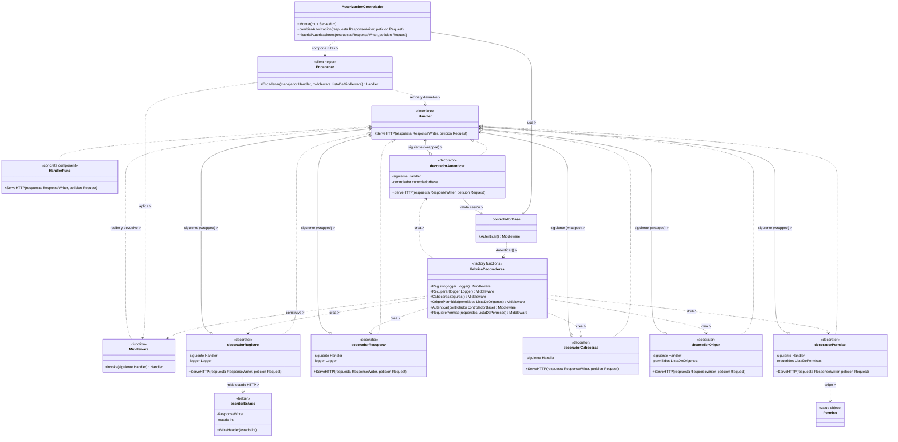

### Decorator

## 1. Archivos fuente necesarios

Todas las rutas son relativas a la raíz de `UniApp`.

| Archivo |
|---|
| `backend/internal/adapters/http/acceso/middleware.go` |
| `backend/internal/adapters/http/acceso/autorizacion_controlador.go` |
| `backend/internal/adapters/http/acceso/controlador_base.go` | 
| `backend/internal/adapters/http/acceso/controlador.go` | 
| `backend/internal/application/acceso/permiso.go` | 
| `backend/internal/domain/acceso/sesion.go` | 

## 2. Diagrama de clases 

