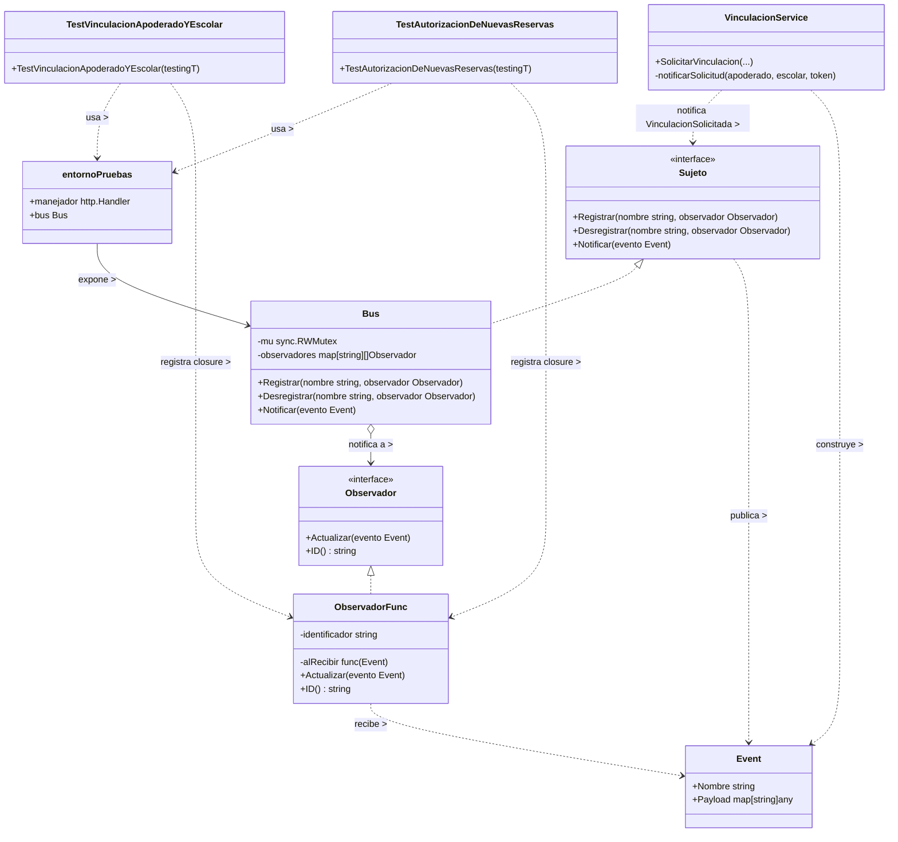

# Observer 

## 1. Archivos fuente necesarios

| Archivo | 
|---|
| `backend/internal/adapters/http/acceso/controlador_vinculacion_test.go` | 
| `backend/internal/adapters/http/acceso/controlador_test.go` | 
| `backend/internal/domain/acceso/eventos.go` | 
| `backend/internal/infrastructure/eventos.go` | 
| `backend/internal/application/acceso/vinculacion_service.go` | 
| `backend/internal/application/acceso/servicio.go` | 

## 2. Diagrama de clases

