# Decorator 

## 1. Archivos fuente necesarios

| Archivo | 
|---|
| `backend/internal/adapters/repositories/postgres/acceso/repo_postgres.go` |
| `backend/internal/adapters/repositories/postgres/acceso/repo_usuarios.go` |
| `backend/internal/adapters/repositories/postgres/acceso/repo_sesiones.go` |
| `backend/internal/adapters/repositories/postgres/acceso/repo_tokens.go` |
| `backend/internal/adapters/repositories/postgres/acceso/repo_vinculaciones.go` |
| `backend/internal/adapters/repositories/postgres/acceso/repo_autorizaciones.go` |
| `backend/internal/adapters/repositories/postgres/acceso/repo_escaneo.go` |
| `backend/internal/domain/acceso/repositorio.go` |
| `backend/internal/domain/acceso/usuario.go` |
| `backend/internal/domain/acceso/sesion.go` |
| `backend/internal/domain/acceso/tokens.go` | 
| `backend/internal/domain/acceso/vinculacion.go` |
| `backend/internal/domain/acceso/autorizacion.go` |
| `backend/cmd/api/main.go` |

## 2. Diagrama de clases

```mermaid
classDiagram
    direction TB

    %% Adaptador PostgreSQL
    class RepositorioPostgres {
        <<adapter>>
        +DB *sql.DB
    }

    %% Target: puertos del dominio
    class RepositorioUsuarios {
        <<interface>>
        +CrearUsuario(ctx Context, usuario Usuario) Usuario, error
        +UsuarioPorEmail(ctx Context, email string) Usuario, error
        +UsuarioPorID(ctx Context, usuarioID string) Usuario, error
        +MarcarCorreoConfirmado(ctx Context, usuarioID string) error
        +ActualizarClave(ctx Context, usuarioID string, hashClave string) error
        +RegistrarIngreso(ctx Context, usuarioID string, momento Time) error
        +EliminarUsuariosSinConfirmar(ctx Context, ahora Time) int64, error
    }

    class RepositorioSesiones {
        <<interface>>
        +GuardarSesion(ctx Context, sesion Sesion) error
        +SesionPorHash(ctx Context, hashToken []byte) Sesion, error
        +EliminarSesion(ctx Context, hashToken []byte) error
        +EliminarSesionesDeUsuario(ctx Context, usuarioID string) error
    }

    class RepositorioTokens {
        <<interface>>
        +GuardarTokenRecuperacion(ctx Context, token TokenRecuperacion) error
        +UsuarioDeTokenRecuperacion(ctx Context, hashToken []byte, ahora Time) string, error
        +ConsumirTokenRecuperacion(ctx Context, hashToken []byte, ahora Time) string, error
        +GuardarTokenConfirmacion(ctx Context, token TokenConfirmacion) error
        +ConsumirTokenConfirmacion(ctx Context, hashToken []byte, ahora Time) string, error
    }

    class RepositorioVinculaciones {
        <<interface>>
        +GuardarSolicitudVinculacion(ctx Context, vinculacion Vinculacion) Vinculacion, error
        +SolicitudPendienteDeEscolar(ctx Context, escolarID string, momento Time) Vinculacion, error
        +SolicitudVinculacionPorToken(ctx Context, consulta ConsultaVinculacionPorToken) Vinculacion, error
        +VinculacionAceptadaDeEscolar(ctx Context, escolarID string) Vinculacion, error
        +ConsumirSolicitudVinculacion(ctx Context, consulta ConsultaVinculacionPorToken) Vinculacion, error
        +VinculacionesDeApoderado(ctx Context, apoderadoID string, momento Time) ListaVinculaciones, error
    }

    class RepositorioAutorizaciones {
        <<interface>>
        +AutorizacionVigenteDeEscolar(ctx Context, escolarID string) Autorizacion, error
        +AutorizacionesDeVinculacion(ctx Context, vinculacionID string) ListaAutorizaciones, error
        +CambiarAutorizacion(ctx Context, cambio CambioAutorizacion) Autorizacion, error
    }

    class Repositorio {
        <<interface>>
    }

    %% Adaptee
    class sql_DB {
        <<external>>
        +ExecContext(ctx Context, query string, args Any) Result, error
        +QueryContext(ctx Context, query string, args Any) Rows, error
        +QueryRowContext(ctx Context, query string, args Any) Row
        +BeginTx(ctx Context, opciones TxOptions) Tx, error
    }

    class sql_Tx {
        <<external>>
        +ExecContext(ctx Context, query string, args Any) Result, error
        +QueryContext(ctx Context, query string, args Any) Rows, error
        +Commit() error
        +Rollback() error
    }

    class sql_Rows {
        <<external>>
        +Scan(destinos Any) error
        +Next() bool
        +Close() error
    }

    %% Escaneo
    class escaneadorFila {
        <<interface>>
        +Scan(destinos Any) error
    }

    %% Dominio persistido
    class Usuario {
        <<domain>>
        +ID string
        +Email string
        +NombreUso string
        +ClaveHash string
        +Rol Rol
        +Activo bool
        +EmailConfirmado bool
        +CreadoEn Time
        +UltimoIngreso Time
    }

    class Sesion {
        <<domain>>
        +TokenHash []byte
        +UsuarioID string
        +ExpiraEn Time
    }

    class TokenRecuperacion {
        <<domain>>
        +TokenHash []byte
        +UsuarioID string
        +ExpiraEn Time
    }

    class TokenConfirmacion {
        <<domain>>
        +TokenHash []byte
        +UsuarioID string
        +ExpiraEn Time
    }

    class Vinculacion {
        <<domain>>
        +ID string
        +ApoderadoID string
        +EscolarID string
        +Estado EstadoVinculacion
        +TokenHash []byte
        +ExpiraEn Time
        +CreadaEn Time
        +AceptadaEn Time
        +Autorizacion Autorizacion
    }

    class Autorizacion {
        <<domain>>
        +ID string
        +VinculacionID string
        +ApoderadoID string
        +EscolarID string
        +Estado EstadoAutorizacion
        +CreadaEn Time
    }

    class CambioAutorizacion {
        <<domain>>
        +VinculacionID string
        +EscolarID string
        +ApoderadoID string
        +Estado EstadoAutorizacion
        +Momento Time
    }

    class ConsultaVinculacionPorToken {
        <<domain>>
        +TokenHash []byte
        +EscolarID string
        +Ahora Time
    }

    %% El adaptador implementa los puertos
    RepositorioPostgres ..|> RepositorioUsuarios
    RepositorioPostgres ..|> RepositorioSesiones
    RepositorioPostgres ..|> RepositorioTokens
    RepositorioPostgres ..|> RepositorioVinculaciones
    RepositorioPostgres ..|> RepositorioAutorizaciones
    RepositorioPostgres ..|> Repositorio

    %% Composición de la interfaz compuesta
    Repositorio o-- RepositorioUsuarios : embebe >
    Repositorio o-- RepositorioSesiones : embebe >
    Repositorio o-- RepositorioTokens : embebe >
    Repositorio o-- RepositorioVinculaciones : embebe >
    Repositorio o-- RepositorioAutorizaciones : embebe >

    %% Adaptee y persistencia
    RepositorioPostgres --> sql_DB : DB >
    RepositorioPostgres ..> sql_Tx : transacciones >
    RepositorioPostgres ..> sql_Rows : consultas >
    RepositorioPostgres ..> escaneadorFila : usa >

    %% Entidades persistidas
    RepositorioPostgres ..> Usuario : persiste >
    RepositorioPostgres ..> Sesion : persiste >
    RepositorioPostgres ..> TokenRecuperacion : persiste >
    RepositorioPostgres ..> TokenConfirmacion : persiste >
    RepositorioPostgres ..> Vinculacion : persiste >
    RepositorioPostgres ..> Autorizacion : persiste >
    RepositorioPostgres ..> CambioAutorizacion : recibe >
    RepositorioPostgres ..> ConsultaVinculacionPorToken : recibe >
```



## 3. Relación con el código

### 3.1. Tipo base

```go
type RepositorioPostgres struct{ DB *sql.DB }
```

`DB` se conserva con el nombre técnico habitual. El composition root construye el struct directamente:

```go
accesoRepo.RepositorioPostgres{DB: baseDatos}
```

No se usa Factory Method: no hay jerarquía de creadores.

### 3.2. Implementación de los puertos

Los métodos están separados por agregado:

| Archivo | Puerto implementado |
|---|---|
| `repo_usuarios.go` | `RepositorioUsuarios` |
| `repo_sesiones.go` | `RepositorioSesiones` |
| `repo_tokens.go` | `RepositorioTokens` |
| `repo_vinculaciones.go` | `RepositorioVinculaciones` |
| `repo_autorizaciones.go` | `RepositorioAutorizaciones` |

La interfaz compuesta `Repositorio` agrupa los cinco puertos para el composition root.

### 3.3. Escaneo de filas

`escaneadorFila` permite reutilizar funciones de escaneo entre `*sql.Row` y `*sql.Rows` sin acoplarlas a un tipo concreto:

```go
type escaneadorFila interface {
    Scan(destinos ...any) error
}
```

## 4. Patrones en el diagrama

| Patrón | Aplicación |
|---|---|
| **Adapter** | `RepositorioPostgres` adapta `database/sql` a los puertos del dominio. |
| **Factory Method** | No aplica: el composition root construye el struct directamente. |
| **Repository** | El puerto y el adaptador implementan persistencia por agregado. |

