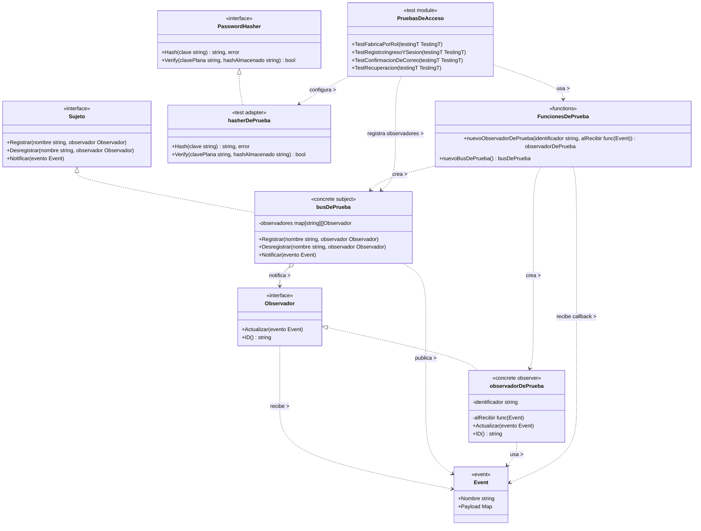

# Observer

## 1. Archivos fuente necesarios

| Archivo |
|---|
| `backend/internal/application/acceso/infra_prueba_test.go` |
| `backend/internal/application/acceso/acceso_test.go` | 
| `backend/internal/domain/acceso/eventos.go` | 
| `backend/internal/domain/acceso/hasher.go` | 
| `backend/internal/application/acceso/servicio.go` |
| `backend/internal/infrastructure/eventos.go` | 

## 2. Diagrama de clases

