# Observer

## 1. Archivos fuente necesarios

| Archivo | 
|---|
| `backend/internal/application/acceso/semilla_test.go` |
| `backend/internal/application/acceso/semilla_demo.go` |
| `backend/internal/application/acceso/acceso_test.go` |
| `backend/internal/application/acceso/vinculacion_service_test.go` | 
| `backend/internal/application/acceso/servicio.go` |
| `backend/internal/application/acceso/registro_service.go` |
| `backend/internal/application/acceso/autorizacion_service.go` |
| `backend/internal/domain/acceso/repositorio.go` |
| `backend/internal/domain/acceso/vinculacion.go` |
| `backend/internal/domain/acceso/autorizacion.go` |
| `backend/internal/domain/acceso/usuario.go` | 

## 2. Diagrama de clases

```mermaid
classDiagram
    direction TB

    %% Prueba
    class TestSembrarVinculacionSinteticaEsIdempotente {
        <<test>>
        +TestSembrarVinculacionSinteticaEsIdempotente(testingT TestingT)
    }

    class PruebasDeAcceso {
        <<fixture helper>>
        +nuevo(testingT TestingT) Servicio, busDePrueba, Time, Contadores
        +solicitudAutorizacion(apoderado Usuario, escolarID string) SolicitudAutorizacion
    }

    %% Funciones de siembra
    class FuncionesDeSiembra {
        <<functions>>
        +Sembrar(contexto Context, servicio Servicio, datos DatosSiembra) error
        +SembrarVinculacion(contexto Context, servicio Servicio, datos DatosSiembraVinculacion) error
    }

    class DatosSiembra {
        <<parameter object>>
        +DominioTutor string
        +Clave string
    }

    class DatosSiembraVinculacion {
        <<parameter object>>
        +EmailApoderado string
        +EmailEscolar string
    }

    %% Aplicación
    class Servicio {
        <<composition root>>
        +Registro RegistroService
        +Autorizacion AutorizacionService
        +RepositorioUsuarios RepositorioUsuarios
        +RepositorioVinculaciones RepositorioVinculaciones
        +Tokens GeneradorTokens
        +Ahora() Time
    }

    class RegistroService {
        +CrearAdministrado(contexto Context, datos SolicitudRegistro) Usuario, error
    }

    class AutorizacionService {
        +HistorialAutorizaciones(contexto Context, solicitud SolicitudAutorizacion) ListaAutorizaciones, error
    }

    %% Puertos
    class RepositorioUsuarios {
        <<interface>>
        +UsuarioPorEmail(contexto Context, email string) Usuario, error
    }

    class RepositorioVinculaciones {
        <<interface>>
        +VinculacionAceptadaDeEscolar(contexto Context, escolarID string) Vinculacion, error
        +GuardarSolicitudVinculacion(contexto Context, vinculacion Vinculacion) Vinculacion, error
        +ConsumirSolicitudVinculacion(contexto Context, consulta ConsultaVinculacionPorToken) Vinculacion, error
    }

    %% Dominio
    class Usuario {
        <<domain>>
        +ID string
        +Email string
        +Rol Rol
    }

    class Vinculacion {
        <<domain>>
        +ID string
        +ApoderadoID string
        +EscolarID string
        +Estado EstadoVinculacion
        +TokenHash []byte
        +ExpiraEn Time
        +CreadaEn Time
    }

    class Autorizacion {
        <<domain>>
        +ID string
        +Estado EstadoAutorizacion
        +CreadaEn Time
        +Vigente() bool
    }

    class SolicitudRegistro {
        <<domain>>
        +Email string
        +NombreUso string
        +Clave string
        +Rol Rol
    }

    class SolicitudAutorizacion {
        <<application>>
        +Apoderado Usuario
        +EscolarID string
    }

    class ConsultaVinculacionPorToken {
        <<domain>>
        +TokenHash []byte
        +EscolarID string
        +Ahora Time
    }

    %% Observer de prueba
    class busDePrueba {
        <<concrete subject>>
        +Registrar(nombre string, observador Observador)
        +Notificar(evento Event)
    }

    class observadorDePrueba {
        <<concrete observer>>
        +Actualizar(evento Event)
        +ID() string
    }

    class Event {
        <<event>>
        +Nombre string
        +Payload Map
    }

    %% Relaciones de la prueba
    TestSembrarVinculacionSinteticaEsIdempotente ..> PruebasDeAcceso : usa fixture >
    TestSembrarVinculacionSinteticaEsIdempotente ..> FuncionesDeSiembra : invoca >
    TestSembrarVinculacionSinteticaEsIdempotente ..> DatosSiembra : construye >
    TestSembrarVinculacionSinteticaEsIdempotente ..> DatosSiembraVinculacion : construye >
    TestSembrarVinculacionSinteticaEsIdempotente ..> Servicio : consulta >
    TestSembrarVinculacionSinteticaEsIdempotente ..> AutorizacionService : verifica historial >

    %% Siembra
    FuncionesDeSiembra ..> DatosSiembra : recibe >
    FuncionesDeSiembra ..> DatosSiembraVinculacion : recibe >
    FuncionesDeSiembra ..> Servicio : usa >
    FuncionesDeSiembra ..> RepositorioUsuarios : consulta >
    FuncionesDeSiembra ..> RepositorioVinculaciones : crea / consulta >
    FuncionesDeSiembra ..> RegistroService : crea cuentas >
    FuncionesDeSiembra ..> Vinculacion : construye >
    FuncionesDeSiembra ..> ConsultaVinculacionPorToken : consume >

    %% Composición del servicio
    Servicio *-- RegistroService : compone >
    Servicio *-- AutorizacionService : compone >
    Servicio --> RepositorioUsuarios : inyecta >
    Servicio --> RepositorioVinculaciones : inyecta >

    %% Dominio
    RegistroService ..> SolicitudRegistro : recibe >
    RegistroService ..> Usuario : crea >
    AutorizacionService ..> SolicitudAutorizacion : recibe >
    AutorizacionService ..> Autorizacion : devuelve >
    RepositorioVinculaciones ..> Vinculacion : persiste >
    RepositorioVinculaciones ..> ConsultaVinculacionPorToken : recibe >

    %% Observer del fixture
    PruebasDeAcceso ..> busDePrueba : crea >
    busDePrueba o--> observadorDePrueba : notifica >
    observadorDePrueba ..> Event : recibe >
```

