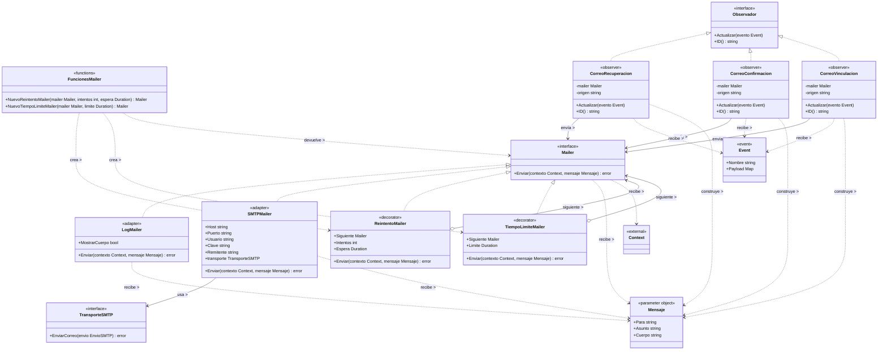

# Adapter, decorator y observer

## 1. Archivos fuente necesarios

Todas las rutas son relativas a la raíz de `UniApp`.

| Archivo | 
|---|
| `backend/internal/domain/acceso/mailer.go` |
| `backend/internal/infrastructure/mailer.go` |
| `backend/internal/infrastructure/observadores.go` |
| `backend/internal/domain/acceso/eventos.go` | 
| `backend/internal/application/acceso/servicio.go` |
| `backend/cmd/api/main.go` |

## 2. Diagrama de clases

