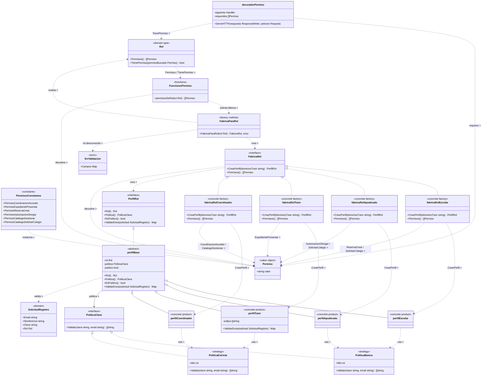

# Abstract factory, strategy 

## 5. Archivos fuente necesarios

| Archivo | 
|---|
| `backend/internal/domain/acceso/permiso.go` |
| `backend/internal/domain/acceso/fabrica_rol.go` |
| `backend/internal/domain/acceso/rol.go` | 
| `backend/internal/domain/acceso/perfil.go` |
| `backend/internal/domain/acceso/validacion.go` |
| `backend/internal/adapters/http/acceso/middleware.go` | 

## 2. Diagrama de clases

