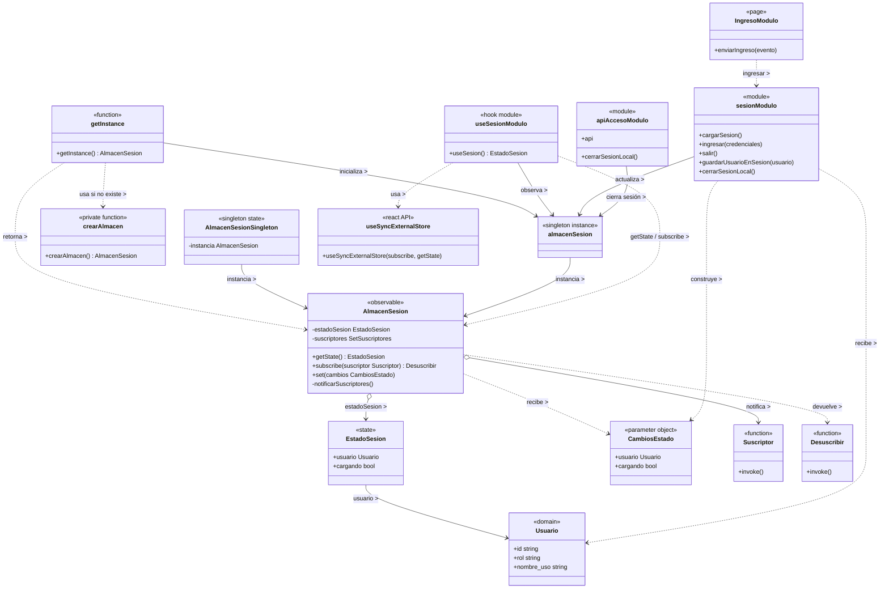

# Singleton y observer

## 1. Archivos fuente necesarios

| Archivo |
|---|
| `frontend/src/application/acceso/almacenSesion.js` |
| `frontend/src/presentation/hooks/useSesion.js` |
| `frontend/src/application/acceso/sesion.js` |
| `frontend/src/adapters/http/apiAcceso.js` |
| `frontend/src/presentation/pages/acceso/Ingreso.jsx` |
| `frontend/src/presentation/pages/acceso/Inicio.jsx` |
| `frontend/src/presentation/pages/acceso/Coordinacion.jsx` |
| `frontend/src/presentation/components/RutaProtegida.jsx` |

## 2. Diagrama de clases

