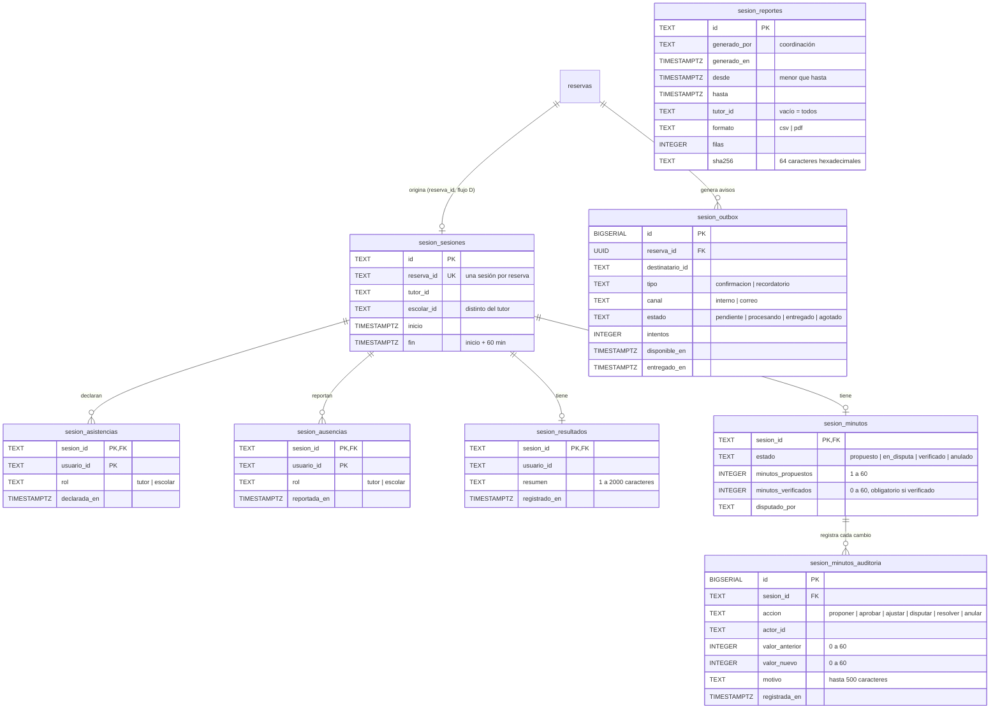
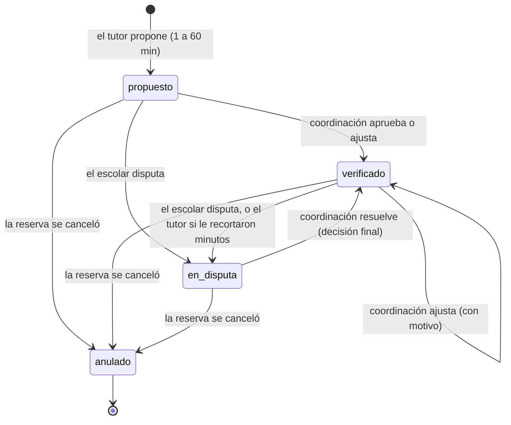

# Modelo de datos del flujo E (agenda, asistencia, minutos y reporte)

Responsable: Marco · Sprint 3 · Fuente: migraciones `005`, `008`, `011`, `012`, `013` y `020`
de `backend/migrations/` (PostgreSQL 16). Este documento describe lo que hay en esas migraciones;
si cambian, hay que actualizarlo.

## 1. Diagrama entidad-relación

`reservas` pertenece al flujo D y solo aparece para mostrar de dónde nace cada sesión.
`sesion_sesiones.reserva_id` no tiene clave foránea (es `TEXT UNIQUE`); `sesion_outbox.reserva_id` sí
referencia `reservas(id)`. `sesion_reportes` no depende de otras tablas: es la constancia de cada descarga.

## 2. Para qué sirve cada tabla

| Tabla | Migración | Issue | Para qué |
|---|---|---|---|
| `sesion_sesiones` | 005 | I05 | La tutoría: quién la dicta, quién la recibe y cuándo (bloque de 60 min) |
| `sesion_asistencias` | 005 | I05 | Cada participante declara que asistió (una vez por persona) |
| `sesion_outbox` | 008 | I10 | Avisos de confirmación y recordatorio pendientes de enviar |
| `sesion_ausencias` | 011 | I11 | Cada participante reporta su propia ausencia |
| `sesion_resultados` | 012 | I11 | Resumen de la tutoría (uno por sesión) |
| `sesion_minutos` | 013 | I17 | Minutos propuestos por el tutor y verificados por coordinación |
| `sesion_minutos_auditoria` | 013 | I17 | Bitácora de cada cambio de los minutos, con actor y motivo |
| `sesion_reportes` | 020 | I18 | Constancia de cada reporte descargado, con su huella SHA-256 |

## 3. Estados de los minutos

Solo el estado `verificado` suma minutos al tutor. `propuesto`, `en_disputa` y `anulado` suman 0.
Toda disputa necesita motivo y vale hasta 7 días después de la sesión; una vez resuelta, no se puede
volver a disputar.
Las transiciones las decide el agregado `RegistroMinutos` (`backend/internal/domain/sesion/minutos.go`);
la base de datos solo impide guardar valores imposibles.

## 4. Reglas que la base de datos hace cumplir

Estas reglas también están en el dominio. La base las repite para que ningún error de código
deje datos inválidos.

| Regla | Cómo se cumple en PostgreSQL |
|---|---|
| Una sesión dura 60 minutos | `CHECK (fin = inicio + INTERVAL '60 minutes')` |
| El tutor no es su propio escolar | `CHECK (tutor_id <> escolar_id)` |
| Una sesión por reserva | `UNIQUE (reserva_id)` |
| Cada persona declara asistencia o ausencia una sola vez | Clave primaria `(sesion_id, usuario_id)` |
| Minutos propuestos entre 1 y 60; verificados entre 0 y 60 | `CHECK … BETWEEN` |
| Un registro verificado siempre tiene valor | `CHECK (estado <> 'verificado' OR minutos_verificados IS NOT NULL)` |
| Estados y acciones válidos | `CHECK (estado IN (…))` y `CHECK (accion IN (…))` |
| La auditoría no se puede editar ni borrar | Trigger `sesion_minutos_auditoria_sin_cambios` (`BEFORE UPDATE OR DELETE` → error) |
| Las constancias de reporte no se pueden editar ni borrar | Trigger `sesion_reportes_sin_cambios` |
| La huella es un SHA-256 válido | `CHECK (sha256 ~ '^[0-9a-f]{64}$')` |
| El periodo del reporte es válido | `CHECK (desde < hasta)` |
| Un aviso no se duplica | `UNIQUE (reserva_id, destinatario_id, tipo, canal)` en `sesion_outbox` |

## 5. Índices

| Índice | Para qué consulta |
|---|---|
| `sesion_minutos_pendientes` (parcial: `propuesto`, `en_disputa`) | Bandeja de revisión de coordinación |
| `sesion_minutos_auditoria_sesion` | Historial de un registro, en orden |
| `sesion_sesiones_inicio` | Reporte por periodo y por tutor |
| `sesion_reportes_recientes` | Últimas constancias generadas |
| `sesion_outbox_pendientes` (parcial) | El despachador busca avisos por enviar |
| `sesion_outbox_bandeja` (parcial) | Bandeja interna de notificaciones de cada usuario |

## 6. Privacidad

- El reporte no guarda ni muestra el nombre del escolar: sale como `ESC-…`, un seudónimo
  calculado con HMAC-SHA256 y una clave del servidor (`domain/sesion/reporte.go`).
- `sesion_reportes` guarda la huella del archivo, no su contenido.

## 7. Migraciones

Cada migración tiene su `.up.sql` y su `.down.sql`, están numeradas y se embeben en el binario de la API.
Las pruebas de los repositorios corren contra PostgreSQL 16 real, igual que en el CI.
